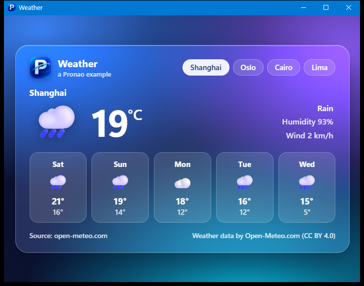
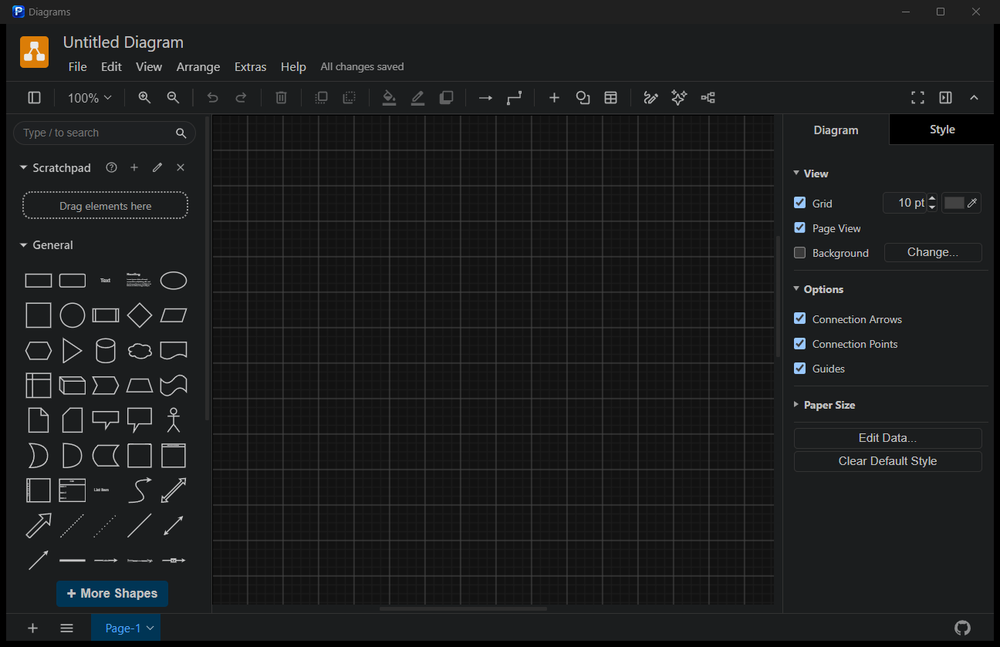
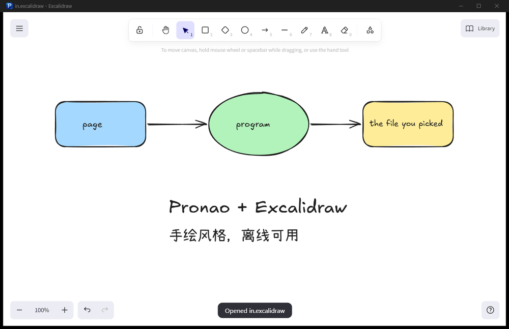

<p align="center"></p>

# Pronao

 

**Desktop apps with a web UI and a checked CeeLing backend.**

Pronao is a framework for building small desktop programs: the window is the system's WebView, the page is HTML and JavaScript, and the commands the page calls are written in [CeeLing](https://github.com/AI4Engr/CeeLing), a memory-safe dialect of C++. The compiler rejects dangling references and use after move, and the page can reach only what the program chose to allow: a folder, a list of programs, a list of commands.

A program is one `.exe` with no installer. The example program below is **1.2 MB** and builds from nothing in 14 seconds; the same four commands in Tauri are 3.1 to 8.6 MB and in Electron 110 MB ([measurements and how to repeat them](docs/comparison/README.md)).

> **Status: prototype.** The API is not stable and may break before 1.0. Windows is the only platform with a window. There are no releases: build from source.
>
> **What the guarantees cover:** only CeeLing code compiled and checked by the CeeLing compiler. The native layer (`shim/`), the WebView and browser engine, any C++ library you link and every `ext_fn` declaration are trusted, not checked. Nothing here is "thread-safe".

<p align="center"></p>

<p align="center"><sub>examples/weather: a page of HTML, CSS and JavaScript with a live forecast. The program, not the page, sends the request, and only to the host it lists.</sub></p>

## Quick start

You need these, and all the scripts are `bash` (Git Bash or MSYS2 on Windows; PowerShell is not used or tried):

| Needed | Why | Notes |
|---|---|---|
| Windows 10 or 11 | the window | the WebView2 Runtime (Windows 11 has it) |
| MinGW-w64 (`g++` on `PATH`), `curl`, Python 3 | compile the program; `fetch.sh` downloads and unpacks | no particular version is pinned; developed with the MSYS2 MinGW-w64 toolchain |
| [CeeLing](https://github.com/AI4Engr/CeeLing) | the compiler | clone it next to this repository and build it (`cmake -S . -B build && cmake --build build`), so that `../CeeLing/build/cling.exe` exists; or set `CLING=` |
| [cJSON-cling](https://github.com/AI4Engr/cJSON-cling) | the JSON the commands receive | clone it next to this repository (`../cJSON-cling`); or set `CJSON=` |

The short way, from a fresh clone of this repository: `bash scripts/setup.sh` checks the tools, clones CeeLing and cJSON-cling next to it if they are missing, builds the compiler (a few minutes) and runs `fetch.sh`. By hand:

```bash
bash scripts/fetch.sh                      # once: webview 0.12.0 and the WebView2 SDK 1.0.2210.55 into third_party/ (pinned, SHA-256 checked, not committed)
bash scripts/new_project.sh ../my-app && cd ../my-app && bash build.sh
```

That builds `out/my-app.exe`: a page, a `main.clg` with one command, and a build script; run it from there. To try what is here first, `PAGE=examples/hello/index.html bash scripts/build.sh examples/hello/main.clg hello.exe`. `scripts/env.sh` says what is missing.

## A complete program

Four commands and a window. More programs are in [examples/](examples/), one for each part below.

```
#include "app.clh"

int main() {
    App app = new App();

    app.command("add", closure Command [] (Item args) {
        return createNumber(numberAt(args, 0) + numberAt(args, 1));
    });
    app.command("mean", closure Command [] (Item args) {
        int n = getArraySize(args);
        if (n == 0) {
            throw "invalid_argument: give at least one number";
        }
        double total = 0.0;
        int i = 0;
        while (i < n) {
            total = total + numberAt(args, i);
            i = i + 1;
        }
        return createNumber(total / n);
    });
    app.command("greet", closure Command [] (Item args) {
        string name = requiredString(args, "name");
        return createString("hello, " + name);
    });
    app.command("fail", closure Command [] (Item args) {
        throw "this command always fails";
    });

    if (!app.openPage("My app", 640, 420, false)) {
        return 1;
    }
    app.run();
    app.close();
    return 0;
}
```

and the page it shows, calling them:

```js
await pronao.invoke('add', [2, 3]);                 // 5
await pronao.invoke('mean', [4, 8, 12]);            // 8
await pronao.invoke('greet', { name: 'Ada' });      // "hello, Ada"
try { await pronao.invoke('fail'); }
catch (e) { console.log(e); }                       // {code: "command_failed", message: "this command always fails"}
```

<details>
<summary><b>Or write the commands in C++</b> (click to expand)</summary>

Pronao is written in CeeLing and compiled to C++, so the framework is also a C++ library: write the program in plain C++, include the headers the compiler generated, and call it. Use this when a command needs a C++ library, or when your team already writes C++. Three of the same commands:

```cpp
#include "app.h"
#include "cjson_item.h"
#include "core.h"

int main() {
    auto app = std::make_shared<App>();

    app->command("add", makeCommand([](std::shared_ptr<Item> args) {
        return createNumber(numberAt(args, 0) + numberAt(args, 1));
    }));
    app->command("greet", makeCommand([](std::shared_ptr<Item> args) {
        return createString("hello, " + requiredString(args, "name"));
    }));
    app->command("fail", makeCommand([](std::shared_ptr<Item>) -> std::shared_ptr<Item> {
        throw std::runtime_error("this command always fails");   // reaches the page as command_failed
    }));

    if (!app->openPage("My app", 640, 420, false)) return 1;
    app->run();
    app->close();
    return 0;
}
```

```
PAGE=examples/cpp/index.html bash scripts/build.sh examples/cpp/main.cpp out/cpp.exe
```

The page is the same, and so are the framework's limits: the file gate, the program list, the command lists and the request limits are still checked CeeLing, and a page reaches only what you allowed. What changes is that the commands you write in C++ are ordinary C++: the CeeLing compiler does not check them for dangling references or use after move, and inserts no bounds or null checks. Keep those commands in CeeLing if you want the guarantee. The complete program is [examples/cpp](examples/cpp/), with a headless check, and the rules are in [appendix C](docs/manual/appendix-cpp.md) of the manual.

</details>

## Compared with Tauri and Electron

The same program in each: the four commands above and a page that calls them. Measured on 2026-11-11 on one Windows 11 machine with 32 cores.

| | Pronao | Tauri 2.12.5 (`--release`) | Tauri, size-tuned | Electron 45.3.0 (one portable `.exe`) |
|---|---|---|---|---|
| program | **1.2 MB** | 8.6 MB | 3.1 MB | 110 MB |
| build from nothing | 14 s | 56 s | 93 s | 103 s |
| edit one command, rebuild | 12 s | 13 to 16 s | 51 s | 103 s |

This is one trivial program, one machine and one build of each. Start-up time and memory were not measured, nor was Tauri's debug profile (`tauri dev`), where its rebuilds are probably much faster. Tauri and Electron have far more features (installers, auto-update, a plugin and permission system, other platforms); a larger Pronao program also takes longer to build, because every module is compiled again. A Pronao program that prints with `std::cout` is 2.0 MB. The sources, the exact commands and the runs are in [docs/comparison](docs/comparison/README.md).

## Real applications: draw.io and Excalidraw

[draw.io](https://github.com/jgraph/drawio) (diagrams.net), a diagram editor whose desktop edition is an Electron program, runs in a Pronao window as **one 22.6 MB `.exe`** (22,588,416 bytes, measured on one machine). Nothing of draw.io is in this repository: `examples/drawio/fetch.sh` downloads a pinned release and checks its hash, and a bridge written for this repository (`pronao-electron.js`) answers the editor's file calls with Pronao's commands. The editor is otherwise unmodified.

```
bash examples/drawio/fetch.sh
RELEASE=1 ICON=docs/assets/pronao.ico ASSETS=examples/drawio/site bash scripts/build.sh examples/drawio/main.clg out/diagrams.exe
```

<p align="center"></p>

The page can read and write **only the files the user picks in an open or save dialog**, nothing around them, and closing the window with unsaved changes asks first. The files are embedded gzip-compressed and inflated when the window asks for them, which took the program from 55.8 MB to 22.6 MB. It took about 6 minutes to build.

What was tested and what was not: the bridge has 12 checks that run without a window, and the editor was started in a real window (also from the packed `.exe`) and saved a file through the bridge. **Not tested:** the native open and save dialogs, export to PNG, SVG and PDF, opening `.vsdx` files and images, printing, and dropping files onto the window. draw.io's own code is Apache-2.0; the Electron shell of its desktop edition is GPL-3.0, none of which is used here; "draw.io" is jgraph's name. Details: [examples/drawio](examples/drawio/README.md).

**Excalidraw** works the other way round: not the whole web application cut down, but its MIT-licensed component in a page of about 150 lines whose file access is Pronao's dialogs. It is **17.4 MB** with its Chinese hand-drawn font and **4.7 MB** without it (`LEAN=1`), against a program that carries a browser. The page cannot reach any address but the program's own (a content-security policy), and the window asks before closing with unsaved work. A test drives the real window: it opens a drawing through the menu, exports PNG and SVG, edits, saves, saves as, and tries to read a file outside the folder it was given (refused); it found a real bug in the page, which is fixed. **The native dialogs are replaced by fixed answers in that test** (a script cannot click them), so how a dialog looks and behaves was not tested. The packages it contains each have their own licence, and a combined notices file is not generated yet. Details: [examples/excalidraw](examples/excalidraw/README.md).

<p align="center"></p>

## What it does

Everything is off until the program turns it on, and a page can ask only for what the program allowed.

* **Commands and events:** named commands with checked arguments, events from CeeLing to the page, errors as `{code, message}`.
* **Files:** an allowed-folder policy decided on the open handle, not on the text of a path; read, write, list, stat, remove.
* **Settings and folders:** per-user data folders and a declared, typed settings file.
* **Dialogs and drag and drop:** a pick or a drop becomes a grant for exactly that file.
* **Watching folders:** change events, merged and re-checked against the permission.
* **HTTP from the program:** requests to hosts the program listed, with the API key kept out of the page, redirects checked hop by hop, limits on size and time (Windows).
* **Programs and links:** a fixed list of programs with typed slots and no shell; addresses and files opened by the system.
* **Windows:** title, size, position, full screen, frameless, modal, several windows, remembered places, one running copy, an icon.
* **Menus and tray:** menu bar and shortcuts, tray icon, pop-up menus, notifications, light and dark.
* **Background work:** async commands on a worker pool, with cancelling and deadlines.
* **Limits on a page:** request size and flood limits, a navigation guard, command lists, release builds without developer tools.
* **A front end of many files and shipping:** a site served from memory, a development server, a release `.exe`, version information, signing.

Each has a chapter in the [manual](docs/manual/README.md) and a program in [examples/](examples/README.md).

## How it works

A simplified flow (it leaves out events, worker threads and windows):

```
page JS --pronao.invoke--> webview bind callback [UI thread] --> mutex queue (shim)
CeeLing main thread:  app_next_call()  <-- blocks on the queue
                      Dispatcher.handle(request)   parse JSON, find the command, call it
                      app_return(id, status, json) --> resolves / rejects the page's promise
```

* **`src/`** is CeeLing, checked by the compiler. Every decision is here: which files a page may reach, which programs it may start, what a dialog may say.
* **`shim/`** is hand-written C++ and is trusted, not checked (about 2,800 lines of code for Windows and 2,600 for Linux, counted by `scripts/shim_lines.sh`). It opens the window, queues calls, opens files and runs programs, as small primitives. It holds no application logic.

CeeLing runs the loop, so no callback has to cross into CeeLing. [How it works](docs/manual/02-how-it-works.md) has the details.

## Platforms

| | |
|---|---|
| Windows 10 and 11 | the platform: the headless suite, real-window tests, a release build, signing. Needs the WebView2 Runtime (Windows 11 has it; `app.checkRuntime` says so on a computer without it) |
| Linux | a first version of the whole window layer on GTK 3 and WebKitGTK: window, dialogs, menu bar, shortcuts, dropped files, one instance, notifications, remembered place; run and tested under WSL with WSLg and on Ubuntu 26.04 under Xvfb + openbox (and a smoke test under headless Wayland), **not yet in a full desktop session with a person at it**. Tray icon (StatusNotifierItem), backend HTTP (libsoup 3), a `.deb` builder; no AppImage / Flatpak. [Appendix D](docs/manual/appendix-linux.md) lists what was run and what was not. Needs `libgtk-3` and `libwebkit2gtk-4.1` on the machine that runs the program |
| macOS | not tried |

## Not a good fit (yet)

Pronao is not a good choice today if you need a window on macOS, a Flatpak or AppImage, an installer or auto-update, a plugin ecosystem, a stable API, or a track record: it is a prototype, its window is mature on one platform (Windows) and new on a second (Linux, tested under WSLg and a virtual X display so far).

## What is and is not checked

CeeLing checks the command table and everything the commands do with their own data: no dangling references, no use after move, no raw pointers, bounds and null checks at run time. For threads the claim is narrow: in the CeeLing code that was checked, a spawned job can reach only its own copies and its own allocations, so there are no data races through `spawn`. **Not checked, and trusted:** the native layer (`shim/`, which includes the WinHTTP calls that carry out a request; what may be requested is decided in checked CeeLing), the `webview` library, the browser engine, every `ext_fn` declaration (a wrong signature is silently believed) and any other C++ you link in. Nothing here is "thread-safe". What needs a real screen (how a menu is drawn, a toast, a real mouse drag) is not seen by the automated tests; each manual chapter says what its tests do and do not see.

## FAQ

**Is it an alternative to Electron or Tauri?** For small programs, in one way: it is much smaller, and the backend is checked. It has far fewer features, no installer or auto-update, and a window on Windows, and a new, less tested one on Linux (no macOS). If you need those, use Tauri or Electron.

**Who is it for?** People who want to write the backend of a desktop program in CeeLing and have the compiler reject its memory errors, and who want one small `.exe` to hand to someone.

**Why "Pronao"?** The *pronaos* is the porch in front of a Greek temple's inner room. The page stands in the porch and may ask; what happens inside is decided by checked code.

## Documentation

* **[User manual](docs/manual/README.md):** ten chapters and four appendices, from getting started to shipping, including [what a command does from the page to the reply](docs/manual/appendix-command-journey.md) and [the compile errors you will meet](docs/manual/appendix-compile-errors.md).
* **[Examples](examples/README.md)** and the [comparison with Tauri and Electron](docs/comparison/README.md).
* [Source map](docs/manual/source-map.md): where things are in the repository.
* [Chapter 16 of the CeeLing guide](https://github.com/AI4Engr/CeeLing/blob/main/docs/language-guide/16-case-study-pronao.md): what the language did to this program, with counts of the checks it inserted and what they cost.

## Contributing

See [CONTRIBUTING.md](CONTRIBUTING.md). To run the tests from the repository root:

```bash
bash tests/run_headless.sh       # about 20 s, no window; runs on Windows and under Linux/WSL
bash tests/run_examples.sh       # builds and checks every example (several minutes)
bash tests/run_sanitizers.sh     # AddressSanitizer, UBSan, ThreadSanitizer; needs WSL with g++
bash tests/run_window_selftest.sh   # a real WebView2 window; Windows only (more real-window scripts: tests/run_*_window.sh)
bash tests/run_window_selftest_linux.sh   # a real GTK window on Linux or WSLg (more: tests/run_*_linux.sh, nine scripts)
```

## License

MIT, see [LICENSE](LICENSE). webview and WebView2 keep their own licenses and are downloaded, not redistributed.
